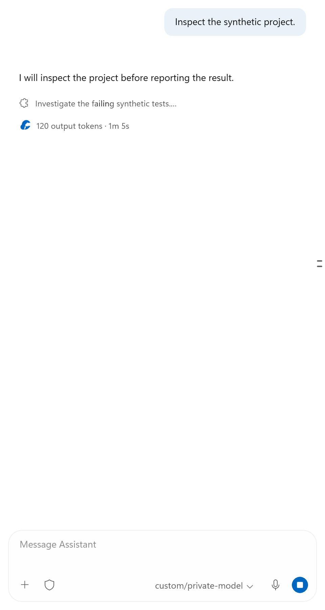
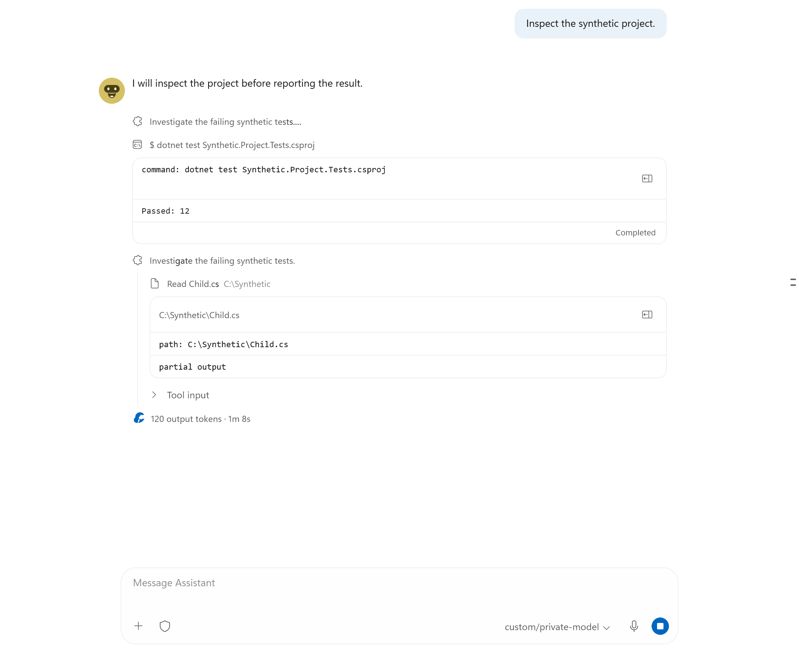
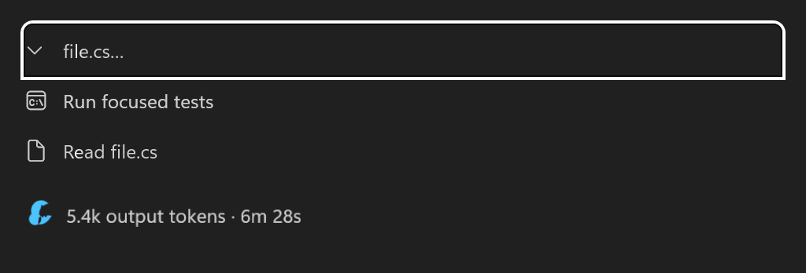
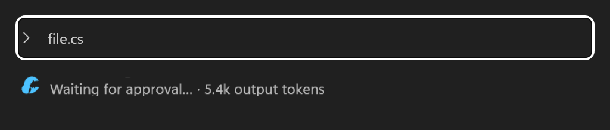
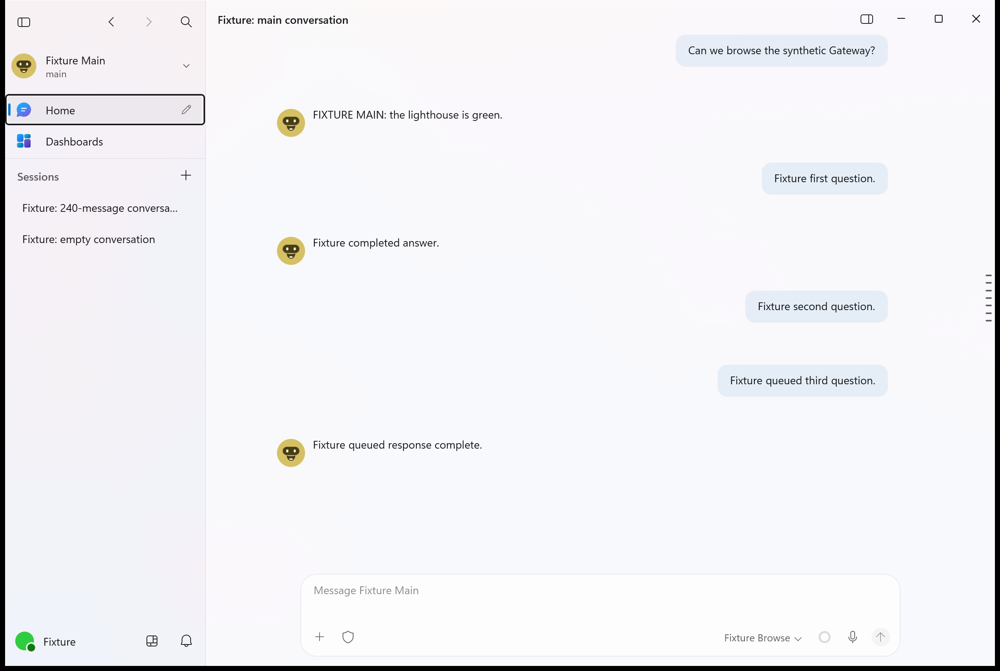

# Companion chat activity / working-footer proof — PR #2374

This package contains only synthetic fixture screenshots and selected, redacted execution facts. No user profiles, credentials, tokens, full runtime configuration or raw Gateway logs are included.

## Source identity and correspondence

PR: https://github.com/openclaw/openclaw-windows-node/pull/2374

The retained captures below show the implementation recorded by `7afbe726851054115205b055fdde591ff5d90c4f`, with upstream `main` `e4bedeb1d2cc2c83706d9098bbac4e7ebd9d3c98` already merged. Production rendering is unchanged by the subsequent collection-precondition assertion. The 43-path source manifest from the full native run is published in [capture-source-manifest.json](evidence/capture-source-manifest.json). It pins the actual raw source used by the run, including the test-only alignment correction that was then committed as `7afbe726`.

The captures were inspected manually by the author. Source equality establishes their correspondence to this rendering implementation; it does not turn them into new screenshots or a run on an untested commit.

## 1. Activity headline and compact working footer

Actual native fixture, narrow 480-DIP reading surface. The visible wrapper headline is retained; there is no duplicate Running badge. The claw and visible output-token/time line are aligned.

Source: native fixture nonce `4b83ce3f925941bfb5a7b0719fe1a961`, `LiveWork_KeepsRunningRowsAndProgressOnTheReadingColumn(width: 480)`. Both 480/1100 cases passed; [exact case results](evidence/live-work-cases.json).

## 2. Individual result and nested activity disclosure

Actual expanded native fixture at 1100 DIP. The completed command retains its Completed result, while its nested read shows partial output. The wrapper headline and token/time footer remain aligned through disclosure changes. The same test also verifies settled Worked disclosure and its output/card geometry.

## 3. Dark theme and approval state

Actual Light/Dark and width matrix from native renderer tests, Release nonce `470fe1940cf546dea767852ff15dd2bb`. In the running state, the footer shows `5.4k output tokens · 6m 28s`. The approval state shows its waiting phase plus tokens and omits elapsed time.

These captures demonstrate the visual state, not a live permission-grant workflow. No execution/admission authority was changed.

## 4. Real Companion process against the isolated synthetic Gateway

A real native ARM64 Release Companion app finished the queued synthetic conversation and retained a usable composer. This is the actual app process rather than an element-graph test. The five selected fixture cases passed in Debug and Release on merge head `3859098e3b59123f5fbe01de7794ca29f165db10`; `7afbe726` changes only the native test file, not the app binary.

Source: Release fixture nonce `045dc02856f24232b58505d7dd8b6ae0`, `completed-run-queue-drained`. The native source/binary and case identity are preserved in the original receipts. This is not live-provider, pairing, WSL/MXC or installer proof.

## 5. Result labels and collection/cleanup trace

- Before the native-state repair, two forced-GC regressions failed with a LinearGradientBrush still attached after stop/unmount. [Redacted before-fix failures](evidence/gc-before.json).
- The native result cases verify a status-less canonical aggregate remains unknown while the individual known Success/Error row exposes Done/failed, including the visible failed text. [Selected native case outcomes](evidence/result-and-cleanup-cases.json).
- The later full renderer/work-layout selection passed 77/77 cases in Debug and Release, without selected skips. [Actual counters](evidence/native-77-counts.json).
- The collection-specific regression uses a test-local ConditionalWeakTable finalizer sentinel, not COM-aware WeakReference.TryGetTarget. The sentinel distinguishes death of the original managed wrapper from rehydration of the still-live native target. The assertion-bearing focused run recorded `Shimmer original wrapper collected: True` and passed all four selected collection/row/result cases. [Direct cleanup trace](evidence/cleanup-trace.txt) and [exact selected cases, source hash and counts](evidence/asserted-collection-and-results.json). This run used `7afbe726` plus the one-line collection assertion, now committed as `51438fac7b2e139f76bdae90e19077531dd7435a`. The subsequent full native selection passed 77/77 in Debug and 77/77 in Release, with collection `True` recorded and asserted in both. Full build, Shared (5,981 passed / 28 skipped), Tray (7,009 passed), all 43 source hashes, and final empty owned-process/task inventories were verified. [Final asserted runtime/cleanup facts](evidence/final-asserted-native-proof.json) and [exact assertion-bearing source hashes](evidence/assertion-bearing-source-manifest.json). These facts are separate from the retained image capture identity; the new commit changes no production rendering.

## Limits retained

The broad native accessibility category is not signed off: fresh merged-source runs had Debug 39/41 and Release 38/41 passing. Remaining failures are the unchanged native Dashboard ButtonShouldHavePatterns rule, a Sessions action-name mismatch, and a Release foreign-foreground clipboard refusal. The merged Dashboard E2E desktop-viewport fix does not establish repair of that different native rule. No foreground guard, tolerance or accessibility assertion was bypassed.

This package supports the changed chat/activity/footer and native lifetime boundaries only. It is not full cross-client pixel equivalence or completion of an entire proof pool. The PR stays a draft unless its owner separately changes that state.
